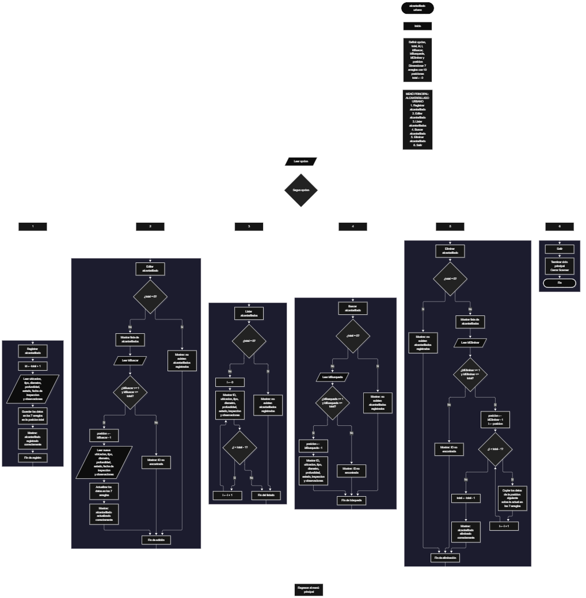

Este proyecto, llamado <b>alcantarillado urbano</b>, fue desarrollado en <b>java</b> como un ejercicio práctico para fortalecer la lógica de programación mediante la creación de un sistema de gestión de alcantarillados desde la consola. El programa cuenta con un menú principal de seis opciones que permite <b>registrar, editar, eliminar, buscar y listar</b> la información de los alcantarillados registrados. Cada registro almacena datos como la ubicación, el tipo de alcantarillado, el diámetro de la tubería, la profundidad, el estado de la instalación, la fecha de inspección y las observaciones, utilizando siete arreglos con una capacidad de <b>10 registros durante la ejecución</b>. Durante su desarrollo se aplicaron conceptos fundamentales de programación, como variables, arreglos, estructuras condicionales, ciclos repetitivos y estructuras de selección, además de procesos para buscar, modificar, eliminar y organizar registros. Este proyecto permite poner en práctica los conocimientos adquiridos en Java y sirve como base para desarrollar sistemas de gestión más avanzados utilizando otros lenguajes y tecnologías.

<h2 align="center">⚙️ Funcionamiento del menú principal</h2>

### ➕ Registrar alcantarillado

La opción <b>1) registrar alcantarillado</b> permite almacenar un nuevo registro en el sistema. Antes de comenzar, el programa genera un identificador utilizando la variable <b>id</b>, mediante la operación <b>total + 1</b>. Después, solicita la <b>ubicación, tipo de alcantarillado, diámetro de la tubería, profundidad, estado de la instalación, fecha de inspección y observaciones</b>. Los datos se almacenan en la posición correspondiente de sus respectivos arreglos: <b>ubicaciones, tipos, diametros, profundidades, estados, fechasInspeccion y observaciones</b>. Finalmente, muestra el mensaje <b>"Alcantarillado registrado correctamente."</b> y aumenta la variable <b>total</b> en uno para actualizar la cantidad de registros almacenados.

### ✏️ Editar alcantarillado

La opción <b>2) editar alcantarillado</b> permite modificar la información de un alcantarillado registrado. Primero, el programa comprueba si existen registros almacenados mediante la variable <b>total</b>. Si no hay alcantarillados registrados, muestra el mensaje <b>"No existen alcantarillados registrados."</b>. En caso contrario, presenta una lista con el ID, ubicación, tipo, diámetro, profundidad, estado, fecha de inspección y observaciones de cada registro. Después, solicita el ID del alcantarillado que se desea editar y comprueba que esté dentro del rango permitido mediante la condición <b>idBuscar &gt;= 1 && idBuscar &lt;= total</b>. Si la selección es válida, calcula la posición correspondiente restando uno al identificador mediante <b>posicion = idBuscar - 1</b>. A continuación, solicita los nuevos datos y actualiza directamente los valores de los siete arreglos. Finalmente, presenta el mensaje <b>"Alcantarillado actualizado correctamente."</b>. Si el ID seleccionado no corresponde a un registro existente, muestra el mensaje <b>"ID no encontrada."</b>.

### 📋 Listar alcantarillados

La opción <b>3) listar alcantarillados</b> permite visualizar todos los registros almacenados actualmente en el sistema. Antes de mostrar la información, el programa comprueba si la variable <b>total</b> es igual a cero. Si no existen alcantarillados registrados, presenta el mensaje <b>"No existen alcantarillados registrados."</b>. Si hay registros disponibles, utiliza un ciclo <b>for</b> para recorrer los arreglos desde la primera posición hasta el número total de alcantarillados registrados. Durante el recorrido, muestra el ID, la ubicación, el tipo, el diámetro de la tubería en centímetros, la profundidad en metros, el estado de la instalación, la fecha de inspección y las observaciones de cada registro. Esta función facilita consultar la información almacenada sin necesidad de buscar cada alcantarillado individualmente.

### 🔎 Buscar alcantarillado

La opción <b>4) buscar alcantarillado</b> permite localizar un registro mediante su identificador. Primero, el programa comprueba si existen alcantarillados registrados. Si no hay información almacenada, muestra el mensaje <b>"No existen alcantarillados registrados."</b>. En caso contrario, solicita el ID del alcantarillado que se desea buscar y verifica que esté dentro del rango permitido mediante la condición <b>idBusqueda &gt;= 1 && idBusqueda &lt;= total</b>. Si el identificador es válido, calcula la posición correspondiente utilizando <b>posicion = idBusqueda - 1</b> y muestra la información completa del alcantarillado encontrado: <b>ubicación, tipo, diámetro, profundidad, estado, fecha de inspección y observaciones</b>. Si el ID introducido no corresponde a ningún registro almacenado, presenta el mensaje <b>"ID no encontrada."</b>.

### 🗑️ Eliminar alcantarillado

La opción <b>5) eliminar alcantarillado</b> permite eliminar un registro mediante su identificador dentro de la lista. Antes de comenzar, el programa comprueba que existan alcantarillados almacenados. Si no hay registros, muestra el mensaje <b>"No existen alcantarillados registrados."</b>. Si existen datos disponibles, presenta una lista con la información de cada alcantarillado. Después, solicita el ID del registro que se desea eliminar y verifica que la selección esté dentro del rango válido mediante la condición <b>idEliminar &gt;= 1 && idEliminar &lt;= total</b>. Si el registro existe, calcula su posición utilizando <b>posicion = idEliminar - 1</b> y comienza el proceso de eliminación. Para mantener los registros organizados, utiliza un ciclo <b>for</b> que desplaza una posición hacia la izquierda los datos posteriores en los siete arreglos: <b>ubicaciones, tipos, diametros, profundidades, estados, fechasInspeccion y observaciones</b>. Posteriormente, disminuye la variable <b>total</b> en uno y muestra el mensaje <b>"Alcantarillado eliminado correctamente."</b>. Si el ID seleccionado no corresponde a un registro existente, presenta el mensaje <b>"ID no encontrada."</b>.

### 🚪 Salir del menú principal

La opción <b>6) salir</b> está destinada a finalizar la ejecución del programa y muestra el mensaje <b>"Gracias por utilizar Alcantarillado Urbano."</b>. El menú principal se encuentra dentro de una estructura repetitiva <b>do-while</b>, que mantiene el programa en funcionamiento mientras se realizan las operaciones disponibles. La condición final es <b>opcion != 6</b>, por lo que al seleccionar la opción 6 el ciclo termina y se ejecuta la instrucción <b>entrada.close()</b>, encargada de cerrar el objeto <b>Scanner</b> utilizado para recibir los datos introducidos por el usuario.

<h2 align="center">🧠 Temas aplicados en el proyecto</h2>

### 📦 Variables

En este proyecto se utilizan variables para guardar la opción seleccionada en el menú, controlar la cantidad de alcantarillados registrados, generar identificadores, recorrer los arreglos y seleccionar los registros que se desean editar, eliminar o buscar. Cada variable cumple una función específica dentro de las operaciones de gestión de la información.

🔢 **Opcion:** Almacena la opción seleccionada por el usuario en el menú principal.

📊 **Total:** Almacena la cantidad actual de alcantarillados registrados.

🆔 **Id:** Genera el identificador del nuevo alcantarillado mediante la operación `total + 1`.

🔎 **IdBuscar:** Almacena el identificador introducido por el usuario para seleccionar el alcantarillado que desea editar.

🔍 **IdBusqueda:** Almacena el identificador introducido por el usuario para realizar la búsqueda de un alcantarillado.

🗑️ **IdEliminar:** Almacena el identificador del alcantarillado que se desea eliminar.

📍 **Posicion:** Permite obtener la posición del registro dentro de los arreglos mediante la resta de uno al identificador seleccionado.

🔄 **I:** Funciona como contador en los ciclos `for` y permite recorrer los arreglos, mostrar los registros y desplazar los datos durante la eliminación.

### 🗃️ Arreglos

En este proyecto se utilizan siete arreglos relacionados con la información de cada alcantarillado. Cada arreglo tiene una capacidad de <b>10 posiciones</b> y utiliza el mismo índice para representar los datos correspondientes a una misma instalación. Por ejemplo, la información de un alcantarillado almacenado en la posición <b>0</b> se encuentra distribuida entre <b>ubicaciones[0], tipos[0], diametros[0], profundidades[0], estados[0], fechasInspeccion[0] y observaciones[0]</b>. Esta organización permite recorrer, buscar, modificar, mostrar y eliminar los registros de manera ordenada.

📍 **Ubicaciones[10]:** Almacena las ubicaciones de los alcantarillados registrados.

🔧 **Tipos[10]:** Almacena los tipos de alcantarillado.

📏 **Diametros[10]:** Almacena los diámetros de las tuberías utilizando datos de tipo `double`, expresados en centímetros.

📐 **Profundidades[10]:** Almacena las profundidades de las instalaciones utilizando datos de tipo `double`, expresados en metros.

⚙️ **Estados[10]:** Almacena los estados de las instalaciones de alcantarillado.

📅 **FechasInspeccion[10]:** Almacena las fechas en las que se realizan las inspecciones.

📝 **Observaciones[10]:** Almacena las observaciones correspondientes a cada alcantarillado.

### 🔀 Estructuras condicionales

En este proyecto se utilizan las estructuras <b>if</b> y <b>else</b> para comprobar si existen alcantarillados registrados antes de realizar determinadas operaciones, verificar que el identificador seleccionado se encuentre dentro del rango permitido y determinar si el registro solicitado existe. Estas condiciones permiten que el programa responda de manera diferente según la cantidad de registros almacenados y el resultado de cada selección. También se utiliza la estructura condicional para mostrar un mensaje cuando el usuario introduce una opción que no corresponde a ninguna de las disponibles en el menú.

### 🔄 Estructuras repetitivas

En este proyecto se utilizan los ciclos <b>for</b> y <b>do-while</b>. Los ciclos <b>for</b> permiten recorrer los arreglos para mostrar los alcantarillados registrados, presentar sus datos durante las operaciones de edición y eliminación, y reorganizar la información cuando se elimina un registro. Por otro lado, el ciclo <b>do-while</b> mantiene activo el menú principal para que el usuario pueda ejecutar las diferentes operaciones disponibles y continuar utilizando el programa hasta seleccionar la opción de salida.

### 🎯 Estructura switch

El programa utiliza la estructura <b>switch</b> para evaluar el valor almacenado en la variable <b>opcion</b> y ejecutar el bloque de instrucciones correspondiente. Cada caso representa una operación específica del sistema: <b>registrar, editar, listar, buscar, eliminar o salir</b>. También se utiliza el bloque <b>default</b> para mostrar el mensaje <b>"Opcion no valida."</b> cuando el usuario introduce un número que no coincide con ninguna de las opciones definidas en el menú. La instrucción <b>break</b> permite finalizar cada caso después de ejecutar su operación correspondiente.

### 🔢 Dimensionamiento de arreglos

El programa utiliza la declaración de arreglos en Java para establecer la capacidad de los espacios donde se almacena la información de los alcantarillados. Se definieron <b>siete arreglos de 10 posiciones cada uno</b>, lo que permite almacenar hasta 10 registros dentro de sus posiciones disponibles. La cantidad de posiciones ocupadas se controla mediante la variable <b>total</b>, por lo que las operaciones recorren únicamente los registros comprendidos entre la primera posición y el total actual de alcantarillados. Sin embargo, el código no incluye una validación que impida superar la capacidad de los arreglos durante el registro.

### 🔄 Reorganización de registros

Cuando se selecciona un alcantarillado para eliminarlo, el programa utiliza un ciclo <b>for</b> que comienza en la posición seleccionada y llega hasta <b>total - 1</b>. En cada repetición, los datos de la posición siguiente se copian sobre la posición actual en los siete arreglos: <b>ubicaciones, tipos, diametros, profundidades, estados, fechasInspeccion y observaciones</b>. Después, la variable <b>total</b> disminuye en uno para actualizar la cantidad de registros activos. De esta manera, los alcantarillados posteriores ocupan las posiciones disponibles sin dejar espacios vacíos entre los registros activos.

<h2 align="center">¿Cómo se implementaron las operaciones crud en el proyecto?</h2>

Las operaciones <b>crud</b> se implementaron mediante las opciones del menú principal, permitiendo administrar la información de los alcantarillados registrados. La operación <b>crear</b> corresponde a <b>registrar alcantarillado</b>, donde se introducen los datos de una nueva instalación; <b>leer</b> se realiza mediante las opciones <b>buscar alcantarillado y listar alcantarillados</b>; <b>actualizar</b> corresponde a <b>editar alcantarillado</b>, donde se modifican los datos de un registro existente; y <b>eliminar</b> se realiza mediante la opción <b>eliminar alcantarillado</b>. Estas operaciones utilizan variables, arreglos, condicionales y ciclos para gestionar la información almacenada temporalmente durante la ejecución del programa.

<h2 align="center">Diagrama de flujo del proyecto</h2>

<h2 align="center">🛡️ Validaciones del programa</h2>

### 📭 No existen alcantarillados registrados

Esta validación se utiliza en las opciones de <b>editar, eliminar, buscar y listar alcantarillados</b>. El programa comprueba si la variable <b>total</b> es igual a <b>0</b> y, si no existen registros almacenados, muestra el mensaje <b>"No existen alcantarillados registrados."</b>. Esta comprobación evita continuar con las operaciones que necesitan información almacenada cuando no hay alcantarillados registrados.

### 🔢 Selección de alcantarillados

El programa utiliza las variables <b>idBuscar, idBusqueda e idEliminar</b> para identificar el alcantarillado que se desea editar, buscar o eliminar. Antes de realizar estas operaciones, comprueba que el identificador introducido sea mayor o igual a <b>1</b> y menor o igual al valor de <b>total</b>. Si la selección está dentro del rango permitido, calcula su posición restando uno al identificador. Si el número introducido no corresponde a un alcantarillado registrado, muestra el mensaje <b>"ID no encontrada."</b>. Esta validación evita modificar, eliminar o consultar posiciones que no corresponden a registros activos.

### ⚠️ Capacidad de los arreglos

Los siete arreglos del programa tienen una capacidad de <b>10 posiciones</b>, por lo que disponen de espacio para almacenar hasta 10 alcantarillados. Sin embargo, en el código actual no se implementa una condición que compruebe si existe espacio disponible antes de registrar un nuevo alcantarillado. Por este motivo, si se intenta registrar un undécimo elemento, el programa puede generar una excepción <b>ArrayIndexOutOfBoundsException</b> al intentar acceder a una posición que no existe dentro de los arreglos.

### ⚠️ Opción inválida

La estructura <b>switch</b> incluye el bloque <b>default</b>, que muestra el mensaje <b>"Opcion no valida."</b> cuando el usuario introduce un número que no corresponde a ninguna de las seis opciones definidas en el menú principal. Esta condición permite informar al usuario cuando selecciona una operación que no está disponible en el sistema.

<h2 align="center">🎯 Objetivo del proyecto</h2>

El objetivo principal de este proyecto es fortalecer la <b>lógica de programación</b> mediante el desarrollo de un sistema de gestión de alcantarillados urbanos en <b>java</b>. A través de su construcción se busca aplicar los conocimientos adquiridos sobre variables, arreglos, estructuras condicionales, ciclos repetitivos y estructuras de selección, integrándolos para resolver un problema de manera organizada. Además, el proyecto permite comprender cómo registrar, consultar, modificar y eliminar información en una aplicación de consola, estableciendo una base para desarrollar sistemas de gestión más completos con otros lenguajes y tecnologías.

